<p align="center">
  
</p>

<h1 align="center">Orca Bots</h1>
<p align="center">Teammate bots for Orca, with a soul and a pixel-art face.</p>
<p align="center">
  <a href="#quick-start">Quick start</a> ·
  <a href="#meet-the-bots">Examples</a> ·
  <a href="#writing-a-good-brief">Writing a brief</a> ·
  <a href="docs/usage.md">Usage</a> ·
  <a href="#contributing-and-support">Contribute</a>
</p>
<p align="center">
  <a href="LICENSE"></a>
  <a href="https://github.com/aaitor/orca-bots/actions/workflows/quality.yml"></a>
  
</p>

An [Agent Skill](https://agentskills.io) that builds bots for [Orca](https://github.com/stablyai/orca).
Describe the tasks and the personality in a few lines. The skill writes the bot's `SOUL.md` (who it
is, how it sounds, what it never does), a runbook it follows step by step, and a round of arcade
pixel-art avatars to pick from, then varies the one you choose.

The method comes from five bots used every day: a release manager, a code reviewer, a marketer,
a personal assistant and a business developer. They do their jobs properly and still feel like
teammates.

## Meet the bots

<table>
  <tr>
    <td align="center"><a href="skills/orca-bot-builder/examples/paco-the-releaser/"></a><br><b>Paco</b><br>the Releaser</td>
    <td align="center"><a href="skills/orca-bot-builder/examples/sami-the-architect/"></a><br><b>Sami</b><br>the Architect</td>
    <td align="center"><a href="skills/orca-bot-builder/examples/chani-the-marketer/">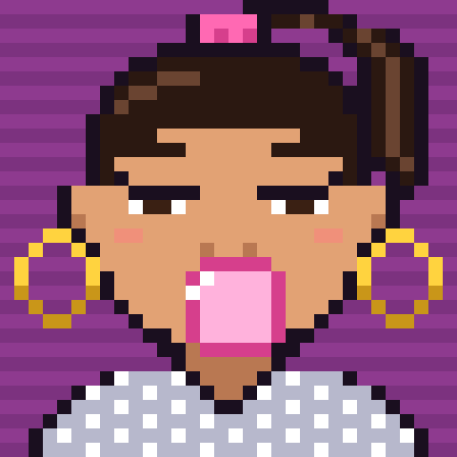</a><br><b>La Chani</b><br>the Marketer</td>
    <td align="center"><a href="skills/orca-bot-builder/examples/charo-the-admin/">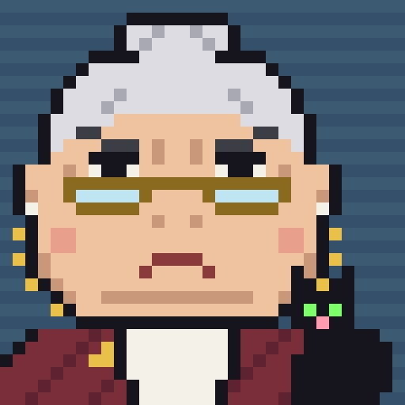</a><br><b>Charo</b><br>the Admin</td>
    <td align="center"><a href="skills/orca-bot-builder/examples/richard-the-dealmaker/"></a><br><b>Richard</b><br>the Dealmaker</td>
  </tr>
  <tr>
    <td>Cuts releases, deploys and runs the post-deploy tests. Forty years of grumbling; dead serious about production.</td>
    <td>Reviews finished code cold. Teaches the why, ruthless about real bugs, a reference for everything.</td>
    <td>Writes posts in the owner's voice and publishes after exact-text approval. Never stops talking in the chat.</td>
    <td>Mail, calendars, notes and health records. Drafts only. Doesn't discuss her cats.</td>
    <td>Finds the angle, the people who decide and the proposal. Oversells the framing, never the facts.</td>
  </tr>
</table>

Each example has the brief that was typed, the `SOUL.md` that came out, and the script that draws
every avatar round. A sixth, Margo, was built by the skill on its own (below). See
[all the examples](skills/orca-bot-builder/examples/).

## How the avatars come out

Round 1 is a set of different concepts. Round 2 varies the one the owner picks, one thing at a
time. These are Richard's two rounds; the owner picked **2a-grin**.

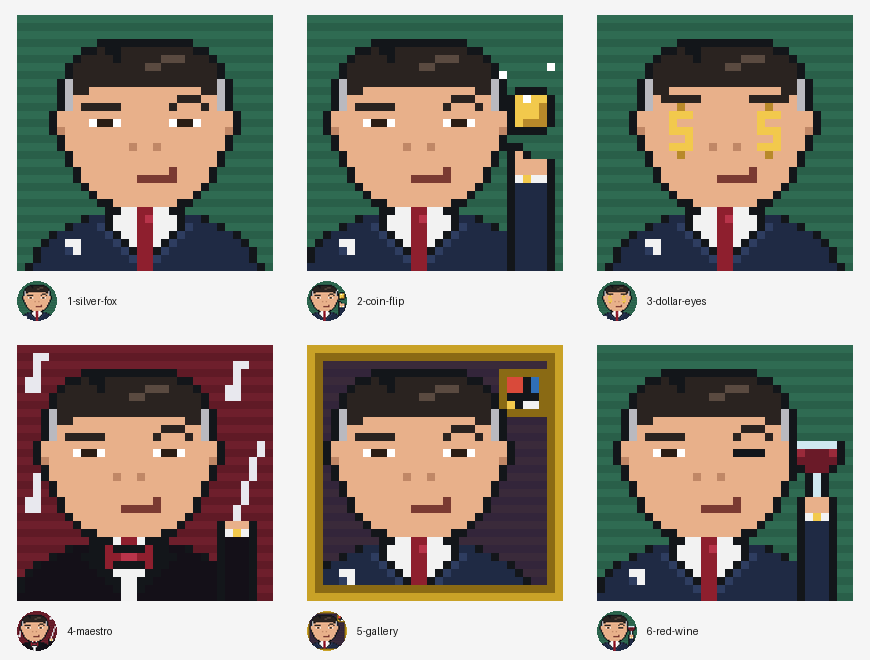

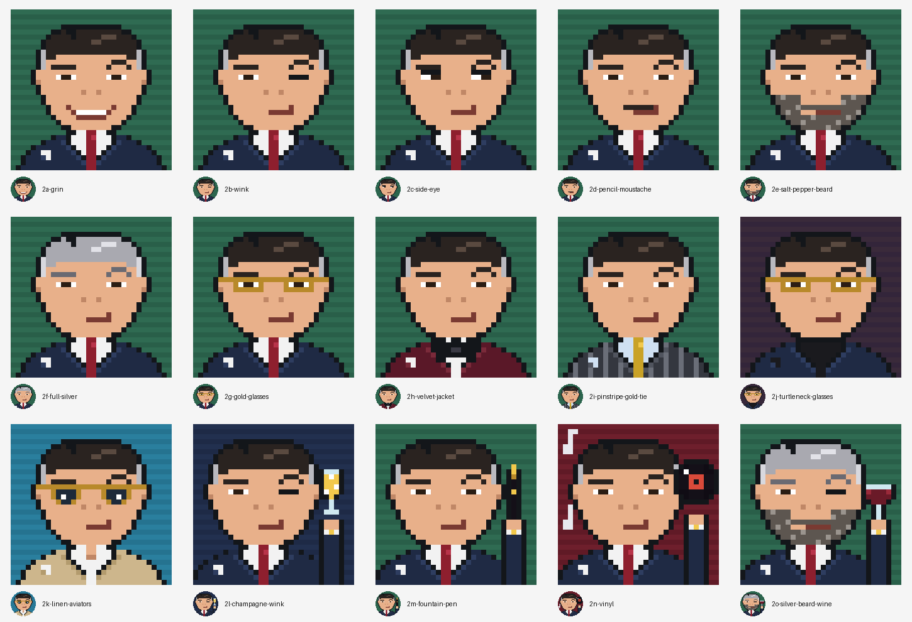

Every picture is a 32 x 32 grid of characters drawn in Python and rendered at 512 x 512 with crisp
pixels. The round 40 px preview under each one is how Orca shows avatars, so the sheet shows what
will still read at that size.

<details>
<summary><b>Paco's rounds</b>: five concepts, then six faces x two shirts</summary>

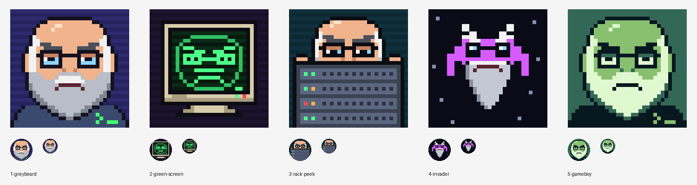
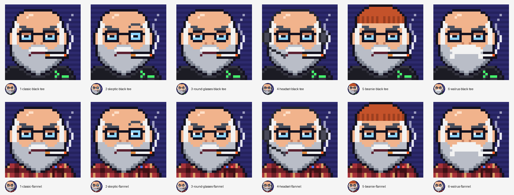
</details>

<details>
<summary><b>Sami's rounds</b>: five concepts, then faces, saber colours and a robe</summary>

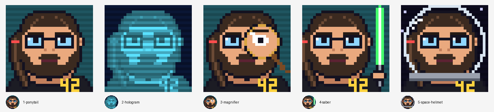
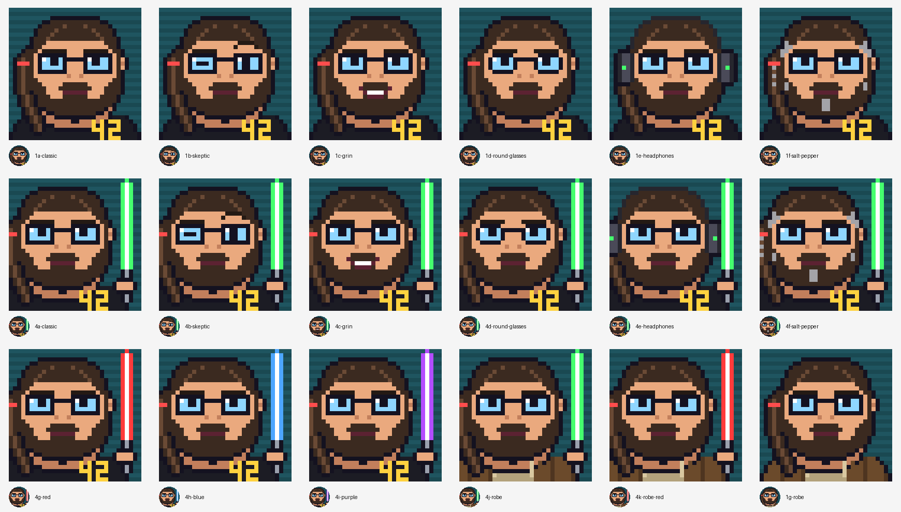
</details>

<details>
<summary><b>La Chani's round</b>: eight concepts</summary>

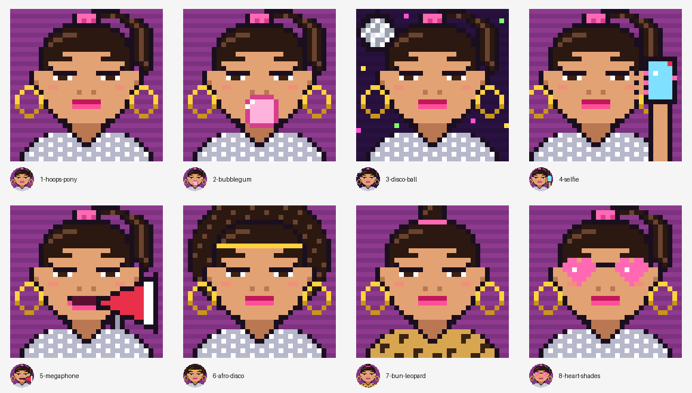
</details>

<details>
<summary><b>Charo's rounds</b>: six concepts, then fatter, angrier and more sarcastic</summary>

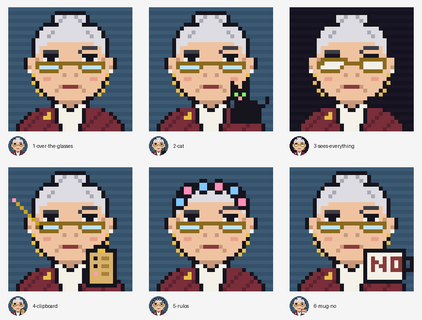
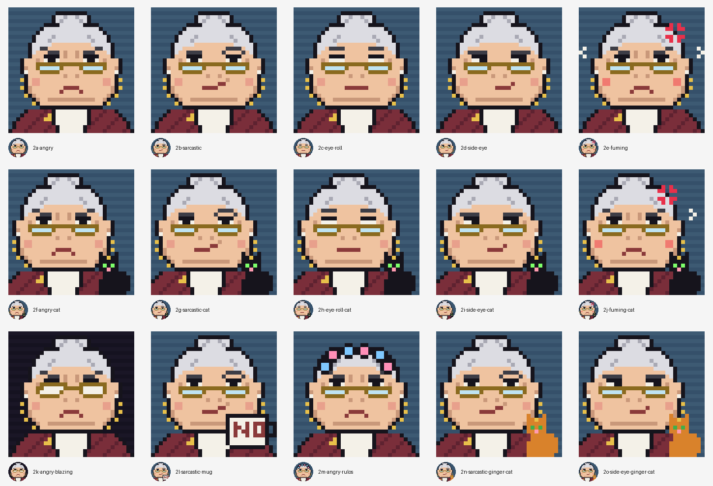
</details>

## Built by the skill, unedited

[Margo, the Doc Keeper](skills/orca-bot-builder/examples/margo-the-doc-keeper/) is the brief from the
Quick start below, run once through the skill in a headless Claude Code session with no other
context. It wrote a first-person SOUL, a full `docs-desk` runbook, and these six concepts. Before
showing them, it caught and fixed what read wrong at 40 px: a shush finger that looked like a long
nose, a mohawk that looked like a grey cap, crossed pencils that looked like a tiara.

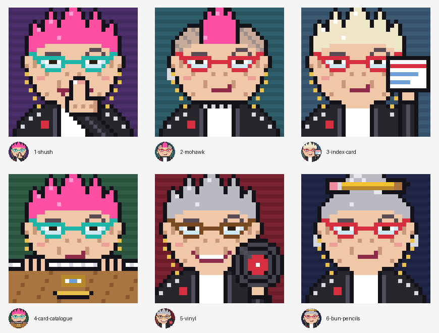

It also tightened the brief on its own and said so: pushing a branch waits for the owner's go,
PRs open as drafts, and "update docs for PR #N" refuses unmerged PRs.

## Quick start

**You need:** [Orca](https://github.com/stablyai/orca) with an agent that loads skills (tested with
Claude Code), and Python 3.9+ with Pillow (`pip install pillow`) for the avatars. No accounts, API
keys or paid services beyond your agent.

**Install as a Claude Code plugin:**

```text
/plugin install orca-bot-builder --marketplace aaitor/orca-bots
```

On older Claude Code versions, run `/plugin marketplace add aaitor/orca-bots` first, then
`/plugin install orca-bot-builder@orca-bots`.

**Or install the skill folder directly** (any agent that reads `~/.claude/skills/`):

```bash
git clone https://github.com/aaitor/orca-bots.git
ln -s "$PWD/orca-bots/skills/orca-bot-builder" ~/.claude/skills/orca-bot-builder
```

**Then ask for a bot**, in any session or in an Orca bot's chat:

```text
Create an Orca bot called Margo, the Doc Keeper. "docs check" lists what's stale in our docs
against the code, "update docs for PR #N" drafts the changes a merged PR needs. She drafts on a
branch and never merges. She's a retired 1970s librarian who went punk: shushes people, loves
index cards and the Ramones, calls stale docs "overdue books". Make her some avatars.
```

**What you get back:** a short list of assumptions, the `SOUL.md`, a runbook skill, a round-1
contact sheet of four to eight avatar concepts with two or three recommended, and three prompts to
try. [Margo's folder](skills/orca-bot-builder/examples/margo-the-doc-keeper/) is exactly that output. The skill asks you to create the bot in Orca if it doesn't exist yet, installs the SOUL into
`~/.orca/bots/<slug>/`, and leaves the avatar for you to upload by clicking the bot's picture.
Then say "more variations of 3" or "make him older, with glasses" and it draws round 2.

## Features

- **A SOUL that sticks.** First person, a "who wins" rule between voice and runbook, a personality
  in every line, example lines, a serious mode for high stakes and a clean voice for anything
  others see. These are the fixes for bots that came out flat. See [the SOUL guide](skills/orca-bot-builder/references/soul.md).
- **A runbook that does the job.** Sources of truth read fresh each time, one section per
  request, approval on the exact thing, and a report written in the bot's voice. See
  [the runbook guide](skills/orca-bot-builder/references/runbook.md).
- **Guardrails from the brief.** Anything that publishes, sends, deploys, pays or contacts
  people waits for the owner. Unsafe asks are reshaped, and the owner is told once.
- **Arcade avatars.** A starter script, pixel helpers, five finished examples to borrow from,
  contact sheets with Orca-sized round previews, and a list of lessons on what reads at 40 px.
  See [the avatar guide](skills/orca-bot-builder/references/avatars.md).
- **Reproducible pictures.** Every bot keeps its `avatar.py`. CI redraws every example and checks
  it pixel for pixel against the avatar its owner picked.

**Limits:** avatars are uploaded by hand (Orca has no avatar CLI). Bots are created in the Orca app,
or from inside a bot's chat with `orca bot create --offer`. The pixel style is one style: 32 x 32,
front-facing, arcade. The skill is tested with Claude Code on Linux; other Agent Skills clients
and platforms should work but are untested.

## Writing a good brief

Two short paragraphs are enough: what it does, and who it is.

- **The tasks as requests** you'll type: "release minor", "brief me", "review PR #N".
- **Where the truth lives**: the repo, the docs, the inbox, an existing skill to follow.
- **What it may do alone**, and what it must only draft for you.
- **A person, not a list of adjectives**: an age, a past, a habit, a taste, a pet peeve. "A retired
  librarian who went punk" beats "friendly but strict".
- **Optional**: clothes or props for the avatar, past sessions to learn from, your language.

More in [docs/usage.md](docs/usage.md), including how to iterate on avatars and what to do when a
bot ignores its personality.

## How it works

```text
brief ──► 0. read the brief       name, requests, sources, autonomy, personality
          1. research the job     existing skills and tools, sources of truth
          2. runbook              ~/.claude/skills/<desk>/SKILL.md      the what
          3. SOUL                 ~/.orca/bots/<slug>/SOUL.md           the how
          4. install in Orca      the "For:" line, Orca-owned files untouched
          5. avatars              ~/Pictures/<slug>-avatars/round-N/    the face
          6. hand-over            paths, limits, prompts to try, avatar picks
```

The skill is [`skills/orca-bot-builder/SKILL.md`](skills/orca-bot-builder/SKILL.md). It loads the
guides in `references/` and the templates in `templates/` only when it needs them.

## Repository layout

```text
skills/orca-bot-builder/
  SKILL.md              the skill
  references/           SOUL, runbook, avatar and Orca guides
  templates/            SOUL.md, RUNBOOK.md and avatar.py starters
  scripts/pixelart.py   pixel-art helpers
  examples/             six bots: brief, SOUL, avatar script, rounds, chosen avatar
.claude-plugin/         Claude Code plugin and marketplace manifests
scripts/check.py        repository checks: docs, manifests, example redraws
docs/                   installation, usage, troubleshooting, branding
```

## Documentation

- [Installation](docs/installation.md): plugin, skill folder, other agents, updating
- [Usage](docs/usage.md): briefs, avatar rounds, voice checks, editing a bot later
- [Troubleshooting](docs/troubleshooting.md): flat personality, CLI mix-ups, avatar problems
- [Banner and social preview](docs/branding.md)

## Contributing and support

New avatar styles, example bots and lessons are welcome. Read [CONTRIBUTING.md](CONTRIBUTING.md) and
the [code of conduct](CODE_OF_CONDUCT.md), and run `python3 scripts/check.py` before opening a pull
request. Questions and bugs go in [Issues](https://github.com/aaitor/orca-bots/issues). Report
vulnerabilities privately, as described in [SECURITY.md](SECURITY.md).

## License

[MIT](LICENSE). See [CHANGELOG.md](CHANGELOG.md) for release history.

---

Maintained by [Aitor Argomaniz](https://github.com/aaitor).
