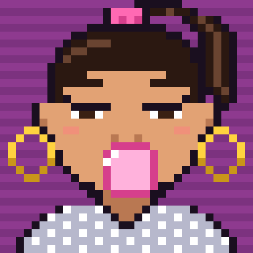
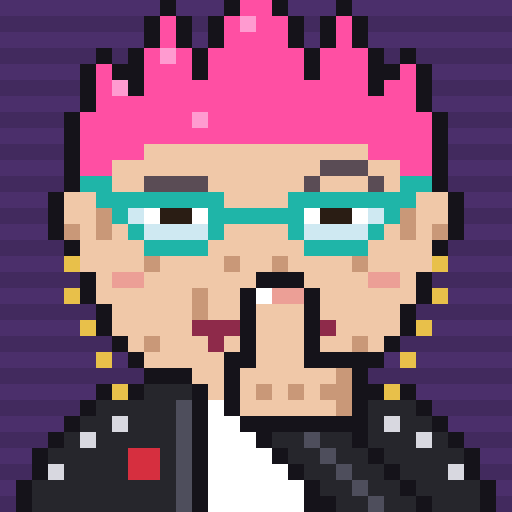

# Examples

Five real bots built with this method, from the brief the owner typed to the avatar they picked,
and one more built by the skill itself.
Owner names and company details are replaced (the owner is "Alex", the company "Acme"); the
personalities, the rounds and the pictures are as they were made. Their runbooks are not included,
because they describe one company's private systems; each README says what its runbook does.
Margo's runbook is included in full (`runbook.md`).

| | Bot | Job | Shows |
|---|---|---|---|
|  | [Paco, the Releaser](paco-the-releaser/) | Releases, deploys, post-deploy tests | A grumpy veteran voice; a serious mode for production; a runbook that was beating the SOUL |
|  | [Sami, the Architect](sami-the-architect/) | Independent code review | A read-only bot; constructive teaching with a ruthless mode; nerd references |
|  | [La Chani, the Marketer](chani-the-marketer/) | Posts in the owner's voice | A loud persona that never leaks into published work; exact-text approval |
|  | [Charo, the Admin](charo-the-admin/) | Mail, calendars, notes, health | Private data; drafts only; a "when it matters" mode; a fatter, angrier round 2 |
|  | [Richard, the Dealmaker](richard-the-dealmaker/) | Partnership angles, people, proposals | Reshaping an unsafe ask (personal data) into a safe one; claims with tense |
|  | [Margo, the Doc Keeper](margo-the-doc-keeper/) | Docs kept true to the code | **Built by the skill in one run, unedited**, including the runbook |

Each folder has the brief and notes (`README.md`), the `SOUL.md`, the `avatar.py` that draws every
round, the round contact sheets and the chosen `avatar.png`. Run any `avatar.py` to redraw its
rounds next to it; it needs Python 3.9+ and Pillow.
