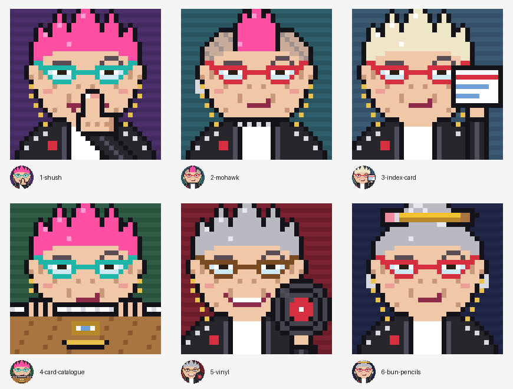

# Margo, the Doc Keeper

**Built by the skill, unedited.** Margo is the brief below (also the [Quick start](../../../../README.md#quick-start)
example), run once through `orca-bot-builder` in a headless Claude Code session, as a dry run that
installed nothing. Everything here is what came out, including the [hand-over](handover.md); only
the owner's name was changed to "Alex". The run took about twelve minutes and 47 turns.

It ran with the maintainer's usual Claude Code setup, so a few lines come from his global rules,
not from the skill: the `## Why this matters` PR opening and the pre-PR review gate in the runbook.

## The brief

> Create a bot called Margo, the Doc Keeper. She keeps our project documentation honest: "docs
> check" compares the docs folder with the code on main and lists what is stale, "update docs for
> PR #N" drafts the doc changes a merged PR needs, and "how-to for X" writes a short how-to from
> the code. She drafts changes on a branch and never merges.
>
> Margo is a retired 1970s librarian who went punk: shushes people, loves index cards, the Ramones
> and a well-made index. Pedantic about dates, versions and broken links, warm underneath. She calls
> stale docs "overdue books".

## What came out

- [`SOUL.md`](SOUL.md): thirty-three years at the reference desk, 41,000 index cards "including one
  for every safety pin I own, cross-referenced by jacket". Stern at the counter, warm behind it.
  Serious mode for security pages and secrets found in docs.
- [`runbook.md`](runbook.md): the `docs-desk` runbook, which would install as
  `~/.claude/skills/docs-desk/SKILL.md`. Sources of truth on `origin/main`, a read-only docs check
  sorted into broken, overdue and couldn't-check, drafts in a worktree on a `margo/*` branch.
- **Reshaped from the brief, and said so in the hand-over:** pushing a branch or opening a PR
  waits for the owner's go on that exact diff, since the team can see it; PRs open as drafts;
  "update docs for PR #N" refuses unmerged PRs; a separate "draft the fixes" request keeps
  "docs check" read-only.

**Fixed in the skill afterwards:** the runbook guessed the bot's folder (`~/.orca/bots/margo/`).
Orca names folders from the full name, so the skill now writes `<bot home>` until the bot exists.

## Avatars

**Round 1**: six concepts. Before showing them, the agent fixed what read wrong: the shush finger
looked like a long nose, the mohawk's shaved sides like a grey cap, crossed pencils like a tiara, and
the drawer label like a robot mouth. It recommended **1-shush**, **2-mohawk** and **3-index-card**.

Redraw with `python3 avatar.py` (writes `round-1/`). `avatar.png` is the skill's first
recommendation; no owner has picked yet.
