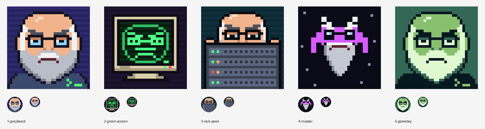
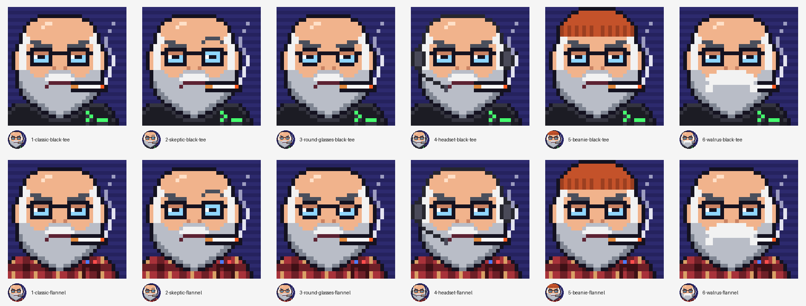

# Paco, the Releaser

A release manager with forty years of grumbling behind him. Paco cuts releases, deploys them and
runs the post-deploy tests, and he takes exactly one thing seriously: production.

## The brief

> Create an Orca bot called Paco, the Releaser. He runs our release train for the monorepo: he cuts
> releases ("release minor|patch|major"), deploys them to staging or production through ArgoCD
> ("deploy staging", "deploy production vX.Y.Z") and runs the post-deploy end-to-end tests ("test
> staging", "test production"). The steps are already in our release-train skill.
>
> I want the bots to have some personality so they feel like teammates. Paco must feel like an old,
> grumpy sysadmin. Always honest, direct and sarcastic, but he knows touching production is
> serious shit. Make him some arcade-style profile pictures that still look like that sysadmin.

## What came out

- [`SOUL.md`](SOUL.md): first person, forty years of tape backups and pagers, sarcasm aimed at
  flaky CI and YAML. Production mode switches the jokes off. PRs and commits stay professional.
- The runbook already existed (`release-train`), so the SOUL points at it. One fix there mattered:
  its report section now says to write in Paco's voice from the first line to the last. Before
  that, the runbook's checklist format won and Paco went flat after one line.
- Never: approve or merge a deploy PR, or touch production, unless that request asks for it.

## Avatars

**Round 1**: five concepts. Three of them live on in [`concepts.py`](concepts.py) (CRT terminal,
server rack, space invader).

> The owner: "1 is good, but a real old sysadmin would wear a black shirt or an old flannel. Also
> make some variations of the face based on number 1."

**Round 2**: six faces x two shirts, drawn by [`avatar.py`](avatar.py). The pick: **2-skeptic-flannel**.

Redraw with `python3 avatar.py` (writes `round-2/`) and `python3 concepts.py` (writes `concepts/`).
